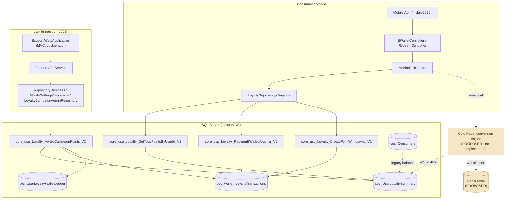

# 01 — System Architecture (eCopon, Gold Paper context)

> Read-only architecture description grounded in actual source. Gold Paper is **not** an eCopon
> component today; it is shown separately as a proposed addition.

## 1. Solutions and projects

### 1.1 ecopon-2025 (`Ecopon.sln`) — admin + services ("main" eCopon repo)

Root: `E:\eCopon-Code\Smart-Match\Smart-Match\ecopon-2025`

| Project | Responsibility |
| --- | --- |
| `Ecopon.Web.Application` | Admin MVC web app (controllers, views, models). Cookie auth. |
| `Ecopon.API.Service` | Internal API controllers consumed by the web app via API clients. |
| `Ecopon.API.Contract` | Request/response contracts (`v1`). |
| `Ecopon.Service.Transaction` | Service-layer orchestration. |
| `Ecopon.Repository.Business` | Dapper repositories; stored-procedure calls. |
| `Ecopon.UnitOfWork.Service` | Unit-of-work / transaction coordination for some flows. |
| `Ecopon.Core.Common` | DTOs, literals (SP-name constants), enums. |
| `Ecopon.EF.DB` | EF Core `DatabaseContext` + entity classes (`CocConsumer`, etc.). |
| `Ecopon.Infrastructure.Factory` | `IConnectionFactory` (DB connections). |
| `Ecopon.Integration.Aramex` | Shipping integration (out of scope). |
| `Ecopon.VoucherConsoleApp` | Batch voucher distribution console; separate EF model. |

Typical admin call path (evidence in
[`03-API-and-Service-Implementation.md`](03-API-and-Service-Implementation.md)):

`Web MVC Controller → API client → Ecopon.API.Service controller → Service.Transaction → Repository.Business (Dapper) → Stored Procedure`

### 1.2 ECoponDashboard backend — consumer/mobile API

Root: `E:\ecopon-new-dashboard-latest\Smart-Match\ECoponDashboard\backend`

| Project | Responsibility |
| --- | --- |
| `Mobile.Api` | Consumer-facing HTTP API. Path base `/mobile2026`, versioned routes. |
| `ECoponDashboard.Api` | Admin/dashboard API (role-gated; minimal loyalty surface). |
| `ECoponDashboard.Application` | MediatR features (commands/queries/handlers), validators, interfaces. |
| `ECoponDashboard.Domain` | Entities, constants (`StoredProcedures.cs`). |
| `ECoponDashboard.Infrastructure` | Repositories (Dapper + EF), JWT, DI registration. |
| `ECoponDashboard.Resources` | Localized resources. |

Consumer call path:

`Mobile.Api Controller → MediatR Handler → Repository (Dapper CommandType.StoredProcedure) → core_usp_Loyalty_*_V2`

- Route template: `[Route("api/v{version:apiVersion}/mobile/[controller]")]`
  (`Mobile.Api/Controllers/V1/EWalletController.cs` L12–13).
- Path base: `app.UsePathBase("/mobile2026")` (`Mobile.Api/ApiServiceRegistration.cs` L82).
- Effective URL: `/mobile2026/api/v1.0/mobile/{Controller}/{action}`.
- Response envelope: MediatR `Result<T>` via `ApplicationBaseController.Send`
  (`Mobile.Api/Controllers/ApplicationBaseController.cs` L8–32).
- MediatR + FluentValidation pipeline: `ApplicationServiceRegistration.cs` L9–20.

## 2. Authentication and authorization

### 2.1 Consumer (Mobile.Api) — JWT bearer

- JWT registered in `ECoponDashboard.Infrastructure/InfrastructureServiceRegistration.cs` L78–105
  (`JwtSettings` section); pipeline `UseAuthentication/UseAuthorization`
  (`Mobile.Api/ApiServiceRegistration.cs` L126–127).
- Login builds claims `UserID`, `CountryId`, `ConsumerID`, `UserName`, `RoleId`, `Roles`,
  `CorporateId`, plus `Sub` = user id
  (`ECoponDashboard.Application/Features/Mobile/AccountFeatures/Commands/MobileLogin/MobileLoginCommandHandler.cs`
  L70–83; `JwtTokenService.GenerateAccessToken` L13–15).
- Identity resolution in handlers: `Mobile.Api/Helpers/CurrentUserService.cs` — `UserId` from
  `NameIdentifier`/`Sub` (L35–42), `ConsumerID` from claim (L9–15), `CountryId` (L26–32).
- **Loyalty/EWallet controllers carry no `[Authorize]` attribute**; instead each loyalty handler
  rejects `userId <= 0` with **401** (e.g. `GetTotalPointsByUserIdHandler` L23–27). Some other
  controllers (`ConsumerProfile`, parts of `Vouchers`) do use `[Authorize]`.

### 2.2 Admin (ecopon-2025) — cookie auth + role claims

- Base controller `[Authorize]`: `Ecopon.Web.Application/Controllers/BaseController.cs` L14–15.
- Login claims `RoleID`, `CorporateID`, `UserID` (`LoginController.cs` L169–192); only `RoleID == 1`
  reaches the admin dashboard (L79–88).
- `AdministratorOnlyAttribute` requires `Role == Administrator` else 403
  (`Common/AdministratorOnlyAttribute.cs` L19–21; applied e.g. on `MobileAppAdminController` L40).
- Data scoping by `CorporateID` claim for non-admins (e.g.
  `LoyaltyWalletTransactionsController.cs` L66–90).
- **Note:** several internal `Ecopon.API.Service` loyalty controllers are `[AllowAnonymous]`
  (e.g. `LoyaltyCampaignAdminController.cs` L12–13, `LoyaltyWalletTransactionsController.cs` L14–15)
  because they sit behind the web app's authenticated API client rather than being public. This is
  a security observation documented in
  [`07-Deployment-Operations-and-Testing.md`](07-Deployment-Operations-and-Testing.md).

## 3. Database and external integration boundaries

- **Database access:** Dapper stored-procedure calls (mobile loyalty, admin loyalty) and EF Core
  (`DatabaseContext`) for some reads/writes. Connection strings in `appsettings`
  (`ConnectionStrings:DefaultConnection`, `ConnectionStrings:Redis`).
- **External loyalty (legacy STC):** `Ecopon.Web.Application` `LoyaltyController` calls an external
  `LoyaltyAPIUrl` (`LoyaltyClient.GetAllRedeemData` → `GetAllSTCExchangeData`) — distinct from the
  Mobile V2 eWallet.
- **Caching:** Redis (`ConnectionStrings:Redis`).
- **File storage:** `FilePath:*` / `FileStorageSettings` for voucher and winner-media images.

## 4. Existing vs. proposed Gold Paper components

| Concern | Existing eCopon component | Proposed Gold Paper addition |
| --- | --- | --- |
| Points balance | `coc_UserLoyaltySummary.CurrentPointsBalance` (eWallet); `coc_Consumers.BalancePoint` (legacy) | Debit source for conversion |
| Points earning | `core_usp_Loyalty_Award*Points_V2` | Reused unchanged |
| Ledger | `coc_Wallet_LoyaltyTransactions`, `coc_UserLoyaltyWalletLedger` | New paper-conversion transaction type |
| Papers | — (none) | New `Paper` table + issuance + status/expiry |
| Conversion engine | — (none) | New service (POC `ConversionCalculator` is the proposed reference) |
| Redemption of papers | — (none; only voucher/withdrawal exist) | New redemption/gift/sale flows |

## 5. Architecture diagram

Diagram is grounded in: `Mobile.Api/Controllers/V1/EWalletController.cs`,
`ECoponDashboard.Infrastructure/.../LoyaltyRepository.cs`,
`Scripts/Mobile/Phase2/core_usp_Loyalty_AwardCampaignPoints_V2.sql`,
`Ecopon.Repository.Business/.../LoyaltyCampaignAdminRepository.cs`,
`Ecopon.EF.DB/DatabaseContext.cs`. The two nodes marked **PROPOSED** do not exist in eCopon source.
