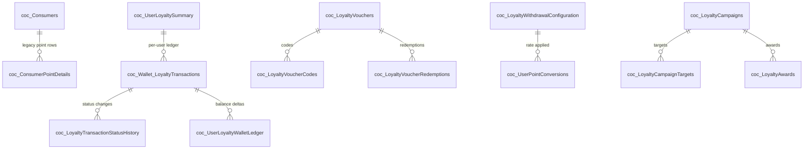

# 02 — Database Design (eCopon loyalty & consumer model)

> Evidence-based. Three layers are kept strictly separate: **(A) Existing production schema**,
> **(B) Proposed schema**, **(C) Standalone POC schema**. Where a physical `CREATE TABLE` is **not**
> present in the inspected repositories, the table is marked accordingly and its columns are given
> only as **inferred from stored-procedure usage or EF entity mapping** — not as authoritative DDL.

## A. Existing production schema

### A.1 Tables with physical `CREATE TABLE` in the repo

Only the loyalty-campaign tables and one table-valued type ship with `CREATE TABLE`/`CREATE TYPE`
DDL in `ecopon-2025`.

#### `dbo.coc_LoyaltyCampaigns`
Source DDL: `Scripts/Mobile/LoyaltyCampaign_Tables.sql` L594–631.

| Column | Type | Notes |
| --- | --- | --- |
| `LoyaltyCampaignID` | `BIGINT IDENTITY(1,1)` | PK (nonclustered) |
| `CampaignCode` | `NVARCHAR(50) NOT NULL` | `UQ_LoyaltyCampaigns_Code` unique |
| `CorporateID` | `INT NOT NULL` | FK → `coc_Corporates` |
| `RewardTypeID` | `TINYINT NOT NULL` | `CHECK IN (1,2)` (1 = points, 2 = cashback) |
| `FixedPoints` | `INT NULL` | `CHECK` required & > 0 when `RewardTypeID = 1` |
| `FixedCashbackAmount` | `DECIMAL(19,4) NULL` | cashback not used by admin (forced NULL) |
| `CurrencyID` | `BIGINT NULL` | |
| `StartDate` / `EndDate` | `DATETIME2(3) NOT NULL` | `CHECK EndDate >= StartDate` |
| `CampaignStatusID` | `TINYINT NOT NULL` DEFAULT 1 | `CHECK IN (1..5)` |
| `Priority` | `INT NOT NULL` DEFAULT 0 | |
| `MaxRewardCountPerConsumer` | `INT NULL` | `CHECK NULL OR > 0` |
| `CreatedDate` | `DATETIME2(3) NOT NULL` DEFAULT `SYSUTCDATETIME()` | |
| `CreatedUserID` | `INT NOT NULL` | FK → `coc_Users` |
| `ModifiedDate` / `ModifiedUserID` | nullable | |
| `RowVersion` | `ROWVERSION` | optimistic concurrency |

Related tables in the same script: `coc_LoyaltyCampaignLanguages` (L665–678, PK
`(LoyaltyCampaignID, LanguageID)`), `coc_LoyaltyCampaignTargets` (L683–716, `TargetTypeID IN (1,2,3)`,
filtered-unique active target index), `coc_LoyaltyCampaignAudits` (L720–742), and the conditional
`coc_LoyaltyCampaignAwards` (L927–967) created only when `coc_LoyaltyAwards` is absent.

#### `dbo.coc_LoyaltyCampaignAwards` (conditional)
Source DDL: `Scripts/Mobile/LoyaltyCampaign_Tables.sql` L927–967. Key columns `LoyaltyCampaignAwardID`
(PK), `LoyaltyCampaignID`, `UserID`, `TargetTypeID`, `TargetID`, `EventReference NVARCHAR(100)`,
`PointsAwarded` (`CHECK > 0`), `WalletTransactionID`, `AwardedDate`, with
`UQ_coc_LoyaltyCampaignAwards_Event (LoyaltyCampaignID, UserID, EventReference)` enforcing event-level
idempotency.

#### `dbo.coc_LoyaltyAwards` (existing table — **no `CREATE TABLE` in repo**)
Only `ALTER`/index statements are present (`LoyaltyCampaign_Tables.sql` L856–921): adds
`UserID INT NULL`, `EventReference NVARCHAR(100) NULL`, `WalletTransactionID BIGINT NULL`, FKs, and
the filtered unique index `UQ_LoyaltyAwards_Campaign_User_Event (LoyaltyCampaignID, UserID,
EventReference) WHERE UserID IS NOT NULL AND EventReference IS NOT NULL`. Phase 2 INSERT columns
(`core_usp_Loyalty_AwardCampaignPoints_V2.sql` L344–417) include `SourceTypeID`,
`ECouponParticipationID`, `SourceReference`, `RewardTypeID`, `PointsAmount`, `AwardStatusID`,
`IdempotencyKey`. **The base table's authoritative DDL could not be verified in the inspected repo.**

#### `dbo.udt_LoyaltyVoucherCode` (table-valued type)
`Scripts/Mobile/udt_LoyaltyVoucherCode.sql` L11–12:
`CREATE TYPE dbo.udt_LoyaltyVoucherCode AS TABLE (VoucherCode NVARCHAR(100) NOT NULL)`.

### A.2 eWallet tables — **physical DDL NOT found in repo** (inferred from SP usage)

The following tables are read/written by the loyalty stored procedures but have **no `CREATE TABLE`**
in either inspected repository and **no EF entity**. Columns below are the **columns referenced by the
procedures**, not a verified schema.

#### `dbo.coc_UserLoyaltySummary`
- Referenced columns: `UserID`, `CurrentPointsBalance`.
- Read/updated under `UPDLOCK, ROWLOCK` by `core_usp_Loyalty_AwardCampaignPoints_V2.sql` L216–217,
  L373–375.
- **This is the eWallet running points balance.** DDL not verified.

#### `dbo.coc_Wallet_LoyaltyTransactions`
- Referenced columns (INSERT): `UserID`, `TransactionTypeID`, `StatusID`, `Points`, `Amount`,
  `CurrencyCode`, `ReferenceNumber`, `FailureReason`, `IsPointsRefunded`, `TransactionDate`,
  `ModifiedDate`, `CompletedDate`, `FailedDate` (`core_usp_Loyalty_AwardCampaignPoints_V2.sql`
  L380–411); PK `TransactionID BIGINT` (admin SELECT `core_usp_GetLoyaltyWalletTransactionAdmin_V2.sql`
  L42–65).
- Lookup tables (no DDL): `coc_LoyaltyTransactionTypes`, `coc_LoyaltyTransactionStatuses`.

#### `dbo.coc_LoyaltyTransactionStatusHistory`
- Referenced columns: `TransactionStatusHistoryID`, `TransactionID`, `PreviousStatusID`,
  `NewStatusID`, `StatusReason`, `ChangedByUserID`, `ChangedDate`, `ReferenceNumber`
  (`core_usp_Loyalty_AwardCampaignPoints_V2.sql` L450–469;
  `core_usp_GetLoyaltyWalletTransactionAdmin_V2.sql` L109–125).

#### `dbo.coc_UserLoyaltyWalletLedger`
- Referenced columns (INSERT): `UserID`, `TransactionType`, `Points`, `BalanceBefore`,
  `BalanceAfter`, `ReferenceID`, `ReferenceType`, `Description`, `CreatedDate`, `CreatedByUserID`
  (`core_usp_Loyalty_AwardCampaignPoints_V2.sql` L423–448).
- A `CHECK` constraint `CK_coc_UserLoyaltyWalletLedger_TransactionType` is altered to add
  `'CampaignReward'` (`Scripts/Mobile/Phase2/LoyaltyCampaign_AddCampaignRewardLedgerType.sql`
  L39–56) — so the table pre-exists; its base DDL is not in the repo.

#### Loyalty voucher tables (DDL not found)
`coc_LoyaltyVouchers` (INSERT cols: `CorporateID`, `ImageUrl`, `VoucherValue`, `CurrencyCode`,
`PointsRequired`, `ValidityHours`, `TotalQuantity`, `RemainingQuantity`, `ValidUntil`, `IsActive`,
timestamps — `core_usp_InsertLoyaltyVoucher_V2.sql` L145–174); `coc_LoyaltyVoucherCodes`
(`VoucherID`, `VoucherCode`, `IsUsed`, `CreatedDate`, `UsedDate`); `coc_LoyaltyVoucherLanguages`;
`coc_LoyaltyVoucherRedemptions` (`RedemptionID`, `VoucherID`, `TransactionID`, `VoucherCodeID`,
`PointsUsed`, `VoucherValue`, `ValidityHours`, `ExpiryDate`, `RedeemedDate` —
`core_usp_GetLoyaltyWalletTransactionAdmin_V2.sql` L66–96).

#### Loyalty withdrawal tables (DDL not found)
`coc_LoyaltyWithdrawalConfiguration` (`MinimumTransferPoints`, `PointsPerCurrencyUnit`,
`CurrencyCode`, `MinimumProcessingHours`, `MaximumProcessingHours`, `IsEnabled` —
`core_usp_InsertLoyaltyWithdrawalConfiguration_V2.sql` L49–70);
`coc_LoyaltyWithdrawalWalletTypes` (`WalletCode`, `WalletName`, `CurrencyCode`, `IsActive`,
`DisplayOrder`, `WalletNumberRegex`, `WalletNumberHint`);
`coc_UserPointConversions` (withdrawal records: `ConversionID`, `WalletCode`, `WalletName`,
`WalletNumber`, `PointsRequested`, `ConversionRate`, `ConversionAmount`, `TransactionID` —
`core_usp_GetLoyaltyWalletTransactionAdmin_V2.sql` L79–85).

> **`PointsPerCurrencyUnit`** is the only point↔currency conversion rate found in production source.
> It is an **admin-configured** value on the withdrawal configuration, not a Gold Paper constant.

### A.3 Consumer identity (EF entity; DDL not in repo)

#### `dbo.coc_Consumers` (`CocConsumer`)
EF entity: `Ecopon.EF.DB/CocConsumer.cs`; mapping `Ecopon.EF.DB/DatabaseContext.cs` L2463–2505.
Loyalty-relevant properties:

| Property | Type | Note |
| --- | --- | --- |
| `ConsumerId` → `ConsumerID` | key | PK |
| `LoyaltyPoint` | `int` | legacy earned total |
| `RedeemPoint` | `int` | legacy redeemed total |
| `BalancePoint` | `int?` | **computed** `([LoyaltyPoint]-[RedeemPoint])` (`DatabaseContext.cs` L2505) |

#### `dbo.coc_ConsumerPointDetails` (`CocConsumerPointDetail`)
EF entity `Ecopon.EF.DB/CocConsumerPointDetail.cs` L10–16; mapping `DatabaseContext.cs` L2816–2843.
Columns: `ConsumerPointDetailId` (PK), `ConsumerId`, `PointDate`, `PointSource (byte)`,
`LoyaltyPoint?`, `RedeemPoint?`, `EcouponId?`.

#### Legacy redemption tables (EF entities; DDL not in repo)
`coc_LoyaltyPointRedemptions` (`CocLoyaltyPointRedemption`, `DatabaseContext.cs` L8263–8304),
`coc_ConsumerRedemptions` (`CocConsumerRedemption`, L2968–3028),
`coc_RedemptionPlans` (`CocRedemptionPlan`; fields `LoyaltyPoint`, `LoyaltyAmount`, L9108–9162).

> **Two distinct balances — do not conflate.** The legacy `coc_Consumers.BalancePoint`
> (= `LoyaltyPoint − RedeemPoint`) and the Phase-2 eWallet `coc_UserLoyaltySummary.CurrentPointsBalance`
> are separate. No inspected source proves they are the same value, and neither is labelled
> "SMPoints". A Gold Paper design must state which balance it debits.

## B. Proposed schema (Gold Paper, not implemented)

No Gold Paper tables exist in eCopon. A future design would need (at minimum) a paper record and a
paper-conversion transaction type. The POC's table shapes (Section C) are the only concrete
reference, and they are **proposals**, not approved schema. Recommended additions are discussed in
[`08-Implementation-Gaps-and-Technical-Plan.md`](08-Implementation-Gaps-and-Technical-Plan.md).

## C. Standalone POC schema (reference only — NOT eCopon)

From `E:\eCopon-Code\Gold-Paper-POC\sql\schema\01-create-tables.sql`. These tables exist only in the
POC database `GoldPaperPoc` and must **not** be assumed to exist in eCopon:

- `dbo.PocBalance` (`SyntheticUserId`, `Points`, `UpdatedAtUtc`).
- `dbo.PocConversion` (idempotent conversion rows; `RateIsApprovedBusinessRule bit` with
  `CHECK (= 0)` L61; unique `(SyntheticUserId, IdempotencyKey)`).
- `dbo.PocPaper` (`Status = 'Available'`, `Source = 'Conversion'` only — L95–96).
- `dbo.PocEvent` (`ConversionCompleted` / `ConversionRejected`).

The POC seeds a single synthetic user `poc-test-user` with 5,000 points
(`sql/schema/02-seed-balance.sql`). The 500-points-per-paper rate is a **POC test assumption**
(see [`05-Business-Rules-and-Requirements.md`](05-Business-Rules-and-Requirements.md)).

## D. Entity-relationship (existing loyalty eWallet)

> Cardinalities reflect usage observed in stored procedures; because most of these tables lack
> physical DDL in the repo, foreign-key enforcement could **not** be verified for the eWallet tables
> (only the `coc_LoyaltyCampaign*` tables have verified FKs).
