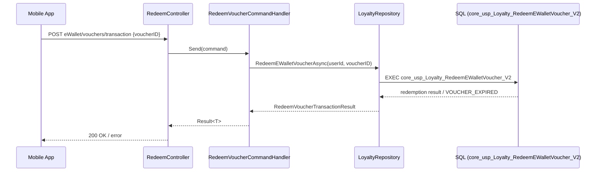
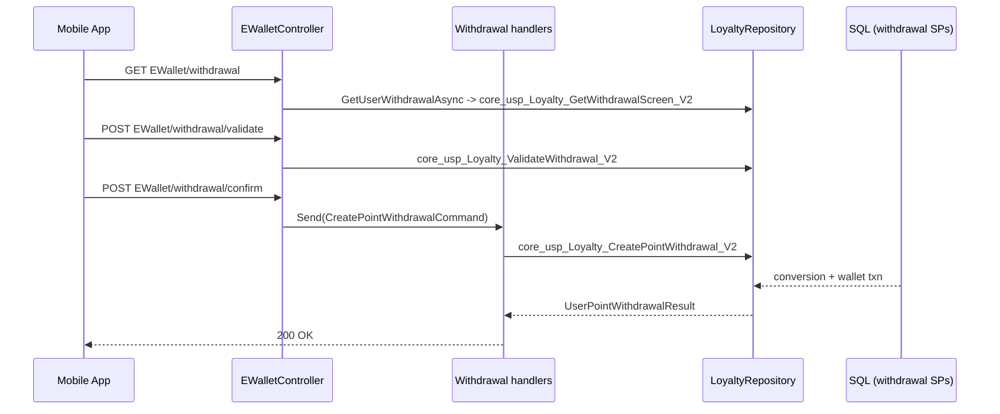

# 04 — End-to-End Business Flows

> Verified flows (from eCopon source) first, each with a sequence diagram. Proposed Gold Paper flows
> are in a separate, clearly-labelled section and must not be read as current production behavior.

## Part 1 — Verified eCopon flows

### 1.1 Read consumer loyalty balance (implemented)

Path: `Entry (mobile app) → EWalletController.total-points → GetTotalPointsByUserIdHandler →
LoyaltyRepository.GetTotalPointsByUserIdAsync → core_usp_Loyalty_GetTotalPointsByUserId_V2 → DB read →
Result<TotalPointsByUserIdResult>`.

- Identity: `CurrentUserService.UserId` from JWT (`NameIdentifier`/`Sub`).
- Business rule: handler returns **401** if `userId <= 0` (`GetTotalPointsByUserIdHandler` L23–27).
- DB effect: read only. SP body not in repo (source table unverified).

```mermaid
sequenceDiagram
    participant App as Mobile App
    participant C as EWalletController
    participant H as GetTotalPointsByUserIdHandler
    participant R as LoyaltyRepository
    participant DB as SQL (core_usp_Loyalty_GetTotalPointsByUserId_V2)
    App->>C: GET /mobile2026/api/v1.0/mobile/EWallet/total-points (JWT)
    C->>H: Send(query)
    H->>H: resolve UserId from JWT; 401 if <= 0
    H->>R: GetTotalPointsByUserIdAsync(userId)
    R->>DB: EXEC core_usp_Loyalty_GetTotalPointsByUserId_V2 @UserID
    DB-->>R: points row
    R-->>H: TotalPointsByUserIdResult
    H-->>C: Result<T>
    C-->>App: 200 OK
```

### 1.2 Redeem points for an eWallet voucher (implemented)

Path: `RedeemController/EWalletController redeem/voucher → RedeemVoucherCommandHandler →
LoyaltyRepository.RedeemEWalletVoucherAsync → core_usp_Loyalty_RedeemEWalletVoucher_V2`.

- Pre-checks available via `voucher/validate/{voucherID}`
  (`core_usp_Loyalty_ValidateEWalletVoucherRedemption_V2`).
- DB effect: writes a wallet transaction + voucher redemption (per
  `coc_LoyaltyVoucherRedemptions` columns). Expiry enforced by SP (`VOUCHER_EXPIRED`, SQL 51005).
- Concurrency/transaction boundaries live **inside the SP**, whose body is not in the repo — so the
  exact locking could not be verified for this consumer SP.



### 1.3 Withdraw points as cash (implemented)

Path: `EWallet/withdrawal (screen) → withdrawal/validate → withdrawal/confirm →
UserPointWithdrawalHandler → core_usp_Loyalty_CreatePointWithdrawal_V2`.

- Rate: `PointsPerCurrencyUnit` from `coc_LoyaltyWithdrawalConfiguration` (admin-configured).
- DB effect: creates a `coc_UserPointConversions` record + wallet transaction.
- Status tracking: `withdrawal/status/{conversionId}` →
  `core_usp_Loyalty_GetPointWithdrawalDetails_V2`.



### 1.4 Earn campaign points (partially implemented — not HTTP-exposed)

Path (data layer only): `LoyaltyCampaignAdminRepository.CallAward →
core_usp_Loyalty_Award{Registration|Referral|ECouponParticipation}Points_V2 →
core_usp_Loyalty_AwardCampaignPoints_V2`.

The campaign-award SP is the **most robust transaction in the inspected source** and is the model a
Gold Paper conversion should follow:

- **Transaction:** `BEGIN TRANSACTION` when `@@TRANCOUNT = 0`, else `SAVE TRANSACTION
  CampaignAwardWrites` (`core_usp_Loyalty_AwardCampaignPoints_V2.sql` L209–212); COMMIT L513–514;
  ROLLBACK (full or to savepoint) L226–229, L537–547.
- **Locking:** `UPDLOCK, ROWLOCK` on `coc_UserLoyaltySummary`, `coc_LoyaltyCampaigns`,
  `coc_LoyaltyCampaignTargets`; `UPDLOCK, HOLDLOCK` on `coc_LoyaltyAwards`.
- **Idempotency:** requires the filtered unique index `UQ_LoyaltyAwards_Campaign_User_Event`
  (L101–114); `@IdempotencyKey` duplicate check (L116–134); event dedupe via existing award row
  (L307–317). Errors `THROW 51010` (missing transaction types), `THROW 51002` (summary update).
- **Writes:** `coc_LoyaltyAwards`, `coc_UserLoyaltySummary.CurrentPointsBalance`,
  `coc_Wallet_LoyaltyTransactions`, `coc_UserLoyaltyWalletLedger`,
  `coc_LoyaltyTransactionStatusHistory`.

```mermaid
sequenceDiagram
    participant Svc as LoyaltyCampaignAdminService
    participant R as LoyaltyCampaignAdminRepository
    participant AW as core_usp_Loyalty_Award*Points_V2
    participant CP as core_usp_Loyalty_AwardCampaignPoints_V2
    participant DB as Summary/Ledger/Txn tables
    Svc->>R: AwardRegistration/Referral/Participation(...)
    R->>AW: EXEC wrapper SP (@OverallResult OUTPUT)
    AW->>CP: evaluate + award
    CP->>DB: lock summary (UPDLOCK,ROWLOCK); dedupe (UQ index)
    CP->>DB: INSERT award + wallet txn + ledger + status history
    CP->>DB: UPDATE CurrentPointsBalance
    DB-->>CP: committed
    CP-->>AW: result
    AW-->>R: @OverallResult
    Note over R: No controller route calls these wrappers (not HTTP-exposed)
```

### 1.5 Competition extra chances (implemented; reusable, not Gold Paper)

Path: `ConsumerProfileController.my-extra-chances → GetMyCompetitionExtraChancesQuery →
ConsumerProfileRepository → core_coc_GetMyCompetitionExtraChances_2026` (read). Related participation
writes: `CompetitionController.SaveECoupons → USP_Core_2026_SaveECouponPurchases`. **No**
`AdditionalChance`/`ExtraChance` write logic tied to papers exists.

## Part 2 — Proposed Gold Paper flows (NOT implemented)

> Clearly marked as future design. These do not exist in eCopon. The POC is the only concrete
> reference and is itself labelled "not an approved business rule".

### 2.1 Proposed: convert points to papers

Intended path: `GoldPaper/convert → conversion handler → lock loyalty balance → compute whole papers
= requested / rate, debit = papers × rate, remainder stays → insert paper rows + conversion + event
atomically → return receipt`. Proposed rules (from POC
[`05-Business-Rules-and-Requirements.md`](05-Business-Rules-and-Requirements.md)): `InsufficientBalance`
wins over `NoWholePaper`; idempotent retry returns the original outcome.

```mermaid
sequenceDiagram
    participant App as Mobile App
    participant GP as GoldPaper handler (PROPOSED)
    participant DB as Loyalty balance + Paper ledger (PROPOSED)
    App->>GP: POST GoldPaper/convert {points, idempotencyKey}
    GP->>DB: lock balance (follow AwardCampaignPoints pattern)
    GP->>DB: compute whole papers, debit, remainder
    GP->>DB: INSERT papers + conversion + event (one txn)
    DB-->>GP: receipt
    GP-->>App: 200 OK (status = Completed / rejected)
    Note over GP,DB: Entire flow is a design proposal; not present in eCopon
```

### 2.2 Proposed but unauthorized

Purchasing papers, selling/transferring papers, gifting papers, paper cashback, paper expiry, and
"additional competition chances from papers" are **not implemented** and are listed in the POC as
"Not included, and not authorized yet" (`Gold-Paper-POC/README.md` L13–19). No flow can be documented
as implemented for these.
