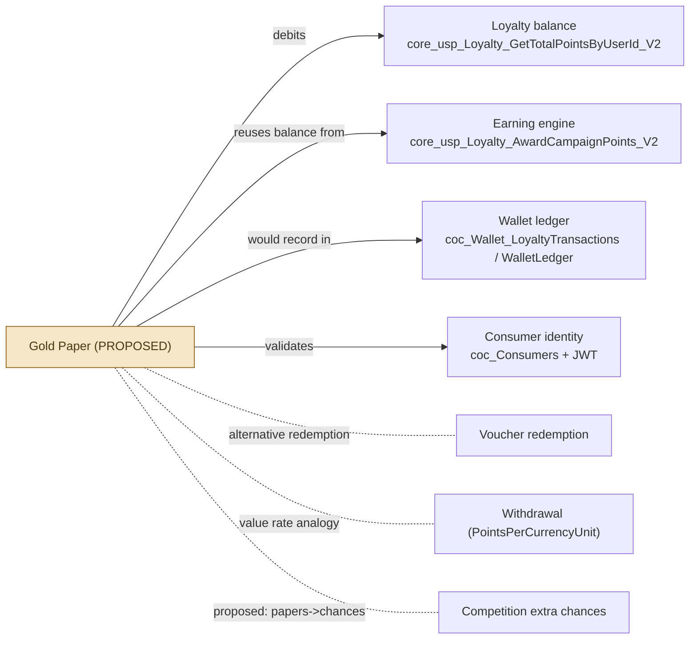

# 06 — Integration and Dependencies

> Verified dependencies (present in eCopon source) are separated from proposed integrations. A Gold
> Paper feature would depend on the existing loyalty platform; those touch-points are listed with
> evidence.

## 1. Verified dependencies (exist in source)

### 1.1 Loyalty point balance & earning
- **Balance read:** `Mobile.Api` `EWallet/total-points` →
  `core_usp_Loyalty_GetTotalPointsByUserId_V2` (`LoyaltyRepository.cs` L45). This is the balance a
  conversion would preview/debit.
- **Earning engine:** `core_usp_Loyalty_AwardCampaignPoints_V2` (and wrappers) update
  `coc_UserLoyaltySummary.CurrentPointsBalance` and write the wallet ledger. Call sites:
  `LoyaltyCampaignAdminRepository.cs` L451–476.
- **Legacy balance:** `coc_Consumers.LoyaltyPoint/RedeemPoint/BalancePoint`
  (`Ecopon.EF.DB/DatabaseContext.cs` L2505, computed). **Separate** from the eWallet summary.

### 1.2 Consumer identity & eligibility
- JWT claims `UserID`, `ConsumerID`, `CorporateId` (`MobileLoginCommandHandler.cs` L70–83);
  resolution via `CurrentUserService` (`Mobile.Api/Helpers/CurrentUserService.cs`).
- Admin consumer profile: `usp_core_GetConsumerProfile`, `usp_core_UpdateConsumerProfileByAdmin`
  (`ConsumerRepository.cs` L435–523); identity checks `usp_core_CheckConsumerIdentityNumber`,
  `core_usp_UpdateConsumerIdentity`.

### 1.3 Voucher & cashback services
- Points→voucher redemption: `core_usp_Loyalty_RedeemEWalletVoucher_V2` (consumer, `Mobile.Api`).
- Voucher catalog admin: `USP_Mobile_GetLoyaltyVouchers_V2`, `core_usp_InsertLoyaltyVoucher_V2`, etc.
  (`MobileSettingsRepository.cs` L732–891).
- **Cashback:** disabled for loyalty campaigns (`FixedCashbackAmount = NULL`,
  `LoyaltyCampaignAdminRepository.cs` L194). No active cashback ledger.

### 1.4 Competition & draw systems
- Participation: `USP_Core_2026_SaveECouponPurchases`,
  `USP_Mobile_SaveECouponPurchasesValidateInvoice` (`Mobile.Api`;
  `ECoponDashboard.Domain/Constants/StoredProcedures.cs` L19).
- Extra chances (read): `core_coc_GetMyCompetitionExtraChances_2026`
  (`ConsumerProfileRepository.cs` L413).
- Draws/winners: `usp_GetDrawWinners` (`Mobile.Api` `GlobalCompetitionRepository.cs`);
  admin `core_usp_GetECoponDraws`, `core_usp_GetWinnersListForVoucher`.
- **Paper Draw (name collision, unrelated):** `core_coc_GetPaperDrawNames`,
  `core_coc_GetPaperDrawWinners` — competition winners, not loyalty papers.

### 1.5 Referral processing
- Campaign referral award: `core_usp_Loyalty_AwardReferralPoints_V2`
  (`LoyaltyCampaignAdminRepository.cs` L461; target type 3, `TargetID == 3`).
- Voucher-package referral code: `core_coc_CheckVoucherPackageReferralCode`
  (`VoucherRepository.ApplyReferralCode` L1501–1516).
- Invite tables `coc_InviteFriends` / `coc_InviteDetails` exist (EF) but the mobile InviteFriends API
  is **commented out** (`MobileServiceController.cs` L430–457).

### 1.6 Wallet transaction & redemption ledgers
- `coc_Wallet_LoyaltyTransactions`, `coc_UserLoyaltyWalletLedger`,
  `coc_LoyaltyTransactionStatusHistory`, `coc_LoyaltyVoucherRedemptions`,
  `coc_UserPointConversions` (see [`02-Database-Design.md`](02-Database-Design.md)). These are the
  canonical place a Gold Paper transaction type would be recorded.

### 1.7 Admin configuration
- Campaign rules (`coc_LoyaltyCampaigns` + targets), voucher catalog, withdrawal configuration
  (`PointsPerCurrencyUnit`), wallet types. All via `ecopon-2025` admin controllers (document 03).

### 1.8 Background workers / batch
- `Ecopon.VoucherConsoleApp` distributes private vouchers to winners
  (`coc_DistributePrivateVouchers`) — not a loyalty-ledger worker.

### 1.9 Notifications & reporting
- Notification entities (`coc_ConsumerNotifications`, `coc_NotificationSends`) exist; winners/report
  SPs under admin. No loyalty-paper notification exists.

## 2. Dependency map

## 3. Proposed integrations (not present)

- A Gold Paper conversion type in `coc_Wallet_LoyaltyTransactions` /
  `CK_coc_UserLoyaltyWalletLedger_TransactionType` (mirroring how `'CampaignReward'` was added in
  `Phase2/LoyaltyCampaign_AddCampaignRewardLedgerType.sql`).
- A paper ledger table and status/expiry worker.
- "Papers → additional competition chances" would require new linkage to the competition
  participation SPs; no such linkage exists today.

All proposed integrations are design recommendations only — see
[`08-Implementation-Gaps-and-Technical-Plan.md`](08-Implementation-Gaps-and-Technical-Plan.md).
