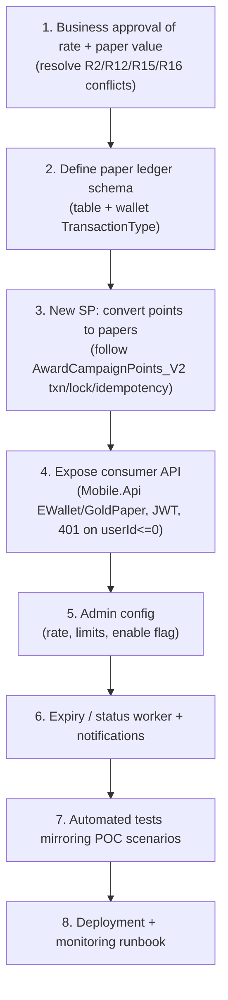

# 08 — Implementation Gaps and Technical Plan

> This document records what is missing for Gold Paper in eCopon and a **proposed** technical plan.
> It introduces **no code or SQL changes**. Everything here is a recommendation that reuses existing,
> verified platform patterns. Nothing below should be read as already built.

## 1. Capability classification (recap)

Legend: **(1)** Implemented & verified · **(2)** Partially implemented · **(3)** Existing reusable,
not Gold-Paper-specific · **(4)** Specified/proposed, not implemented · **(5)** Unverified (missing
source).

| Capability | Class | Evidence |
| --- | --- | --- |
| Read loyalty balance | 1 | `core_usp_Loyalty_GetTotalPointsByUserId_V2` via `EWallet/total-points` |
| Voucher redemption | 1 | `core_usp_Loyalty_RedeemEWalletVoucher_V2` |
| Cash withdrawal (points→SAR) | 1 | withdrawal SPs + `PointsPerCurrencyUnit` |
| Competition extra chances (read) | 1/3 | `core_coc_GetMyCompetitionExtraChances_2026` |
| Campaign point earning engine | 2 | `core_usp_Loyalty_AwardCampaignPoints_V2` present; **not HTTP-exposed** |
| Wallet ledger / status history | 3 | `coc_Wallet_LoyaltyTransactions`, `coc_UserLoyaltyWalletLedger` |
| Idempotency/concurrency pattern | 3 | `UQ_LoyaltyAwards_Campaign_User_Event`, `UPDLOCK/HOLDLOCK` |
| **Gold Paper points→paper conversion** | 4 | POC only; absent from eCopon |
| **Paper ledger / issuance / expiry** | 4 | POC only |
| **Papers → competition chances** | 4 | no source linkage |
| Paper purchase / transfer / gift / cashback | 4 | explicitly "not authorized yet" (POC README) |
| Consumer eWallet SP bodies | 5 | invoked by name; bodies not in inspected repo |
| Hosting / CI-CD / monitoring | 5 | not found in source |
| 10 SAR/paper, 0.020 halala, SMPoints, max limits | 5 | brief only; not in any source |

## 2. Gaps (what is missing in eCopon)

1. **No Gold Paper domain.** No controller, handler, entity, SP, or table for papers or point→paper
   conversion exists in eCopon. (Verified by repo-wide search; only `PaperDraw` competition naming
   collides.)
2. **No approved conversion rate.** Every rate in evidence is unapproved (POC 500) or belongs to a
   different feature (withdrawal `PointsPerCurrencyUnit`). The brief's 10 SAR/paper and 0.020 halala
   are unverified. See [`05-Business-Rules-and-Requirements.md`](05-Business-Rules-and-Requirements.md).
3. **Earning engine not HTTP-exposed.** `Award*Points_V2` wrappers have no controller route; a
   conversion that must occur after earning has no current API trigger.
4. **Missing SP bodies.** Consumer eWallet SP bodies are outside the inspected source, so exact
   balance-mutation semantics for the consumer path are unverified.
5. **No paper ledger / transaction type.** The wallet ledger has no Gold-Paper transaction type.
6. **No limits / expiry / notifications** for papers.

## 3. Proposed technical plan (design only — DO NOT implement from this doc)

### 3.1 Guiding principle
Reuse the **verified** `core_usp_Loyalty_AwardCampaignPoints_V2` transaction pattern rather than the
POC's in-memory store. The POC validated the *rules*; the *implementation* in eCopon must use the
production ledger and locking model.

### 3.2 Proposed sequence (future work, ordered)

### 3.3 Design notes per step
- **Step 2 (schema):** add paper table(s) and a new allowed value in
  `CK_coc_UserLoyaltyWalletLedger_TransactionType`, mirroring how `'CampaignReward'` was added
  (`Phase2/LoyaltyCampaign_AddCampaignRewardLedgerType.sql`). *Proposal only — no script written.*
- **Step 3 (SP):** `BEGIN TRAN`/`SAVE TRAN`; `UPDLOCK, ROWLOCK` on `coc_UserLoyaltySummary`; filtered
  unique index for idempotency; `THROW` codes for insufficient balance / no whole paper; enforce
  `InsufficientBalance` precedence (R7).
- **Step 4 (API):** controller + MediatR handler + FluentValidation, matching the existing
  `EWalletController` conventions (401 when `userId <= 0`).
- **Step 7 (tests):** port the POC's five scenarios (success, insufficient, no whole paper, idempotent
  retry, sticky rejection) to an eCopon integration test project.

### 3.4 Explicitly out of scope until authorized
Paper purchase, sale/transfer, gifting, cashback, and "papers → extra competition chances" are listed
as **not authorized** (POC README L13–19) and must not be designed further without product sign-off.

## 4. Open decisions (owners required)

| Decision | Options in evidence | Owner |
| --- | --- | --- |
| Point→paper rate | 500 (POC, unapproved) vs. derive from withdrawal `PointsPerCurrencyUnit` | Business / Finance |
| Paper monetary value | 10 SAR (unverified) vs. none in source | Finance |
| Point value | 0.020 halala (unverified) vs. 100 pts=1 SAR vs. 0.025 SAR draft | Finance |
| Max papers / max chances | unverified; brief calls them conflicting | Product |
| Papers ↔ competition chances | no source; feasibility unknown | Product + Eng |
| Earning API exposure | wrappers exist but unrouted | Engineering |

## 5. Risks
- **Financial correctness:** conflicting point values (document 05) must be resolved before any
  conversion ships; shipping the POC's 500 rate would persist `RateIsApprovedBusinessRule = 0`.
- **Double-spend:** must reuse the verified locking/idempotency pattern, not the in-memory POC store.
- **Hidden SP semantics:** consumer eWallet SP bodies are unverified; integration must confirm actual
  balance mutation behavior before relying on it.

> This plan is advisory. No eCopon code, SQL, or configuration has been or should be changed on the
> basis of this document alone.
