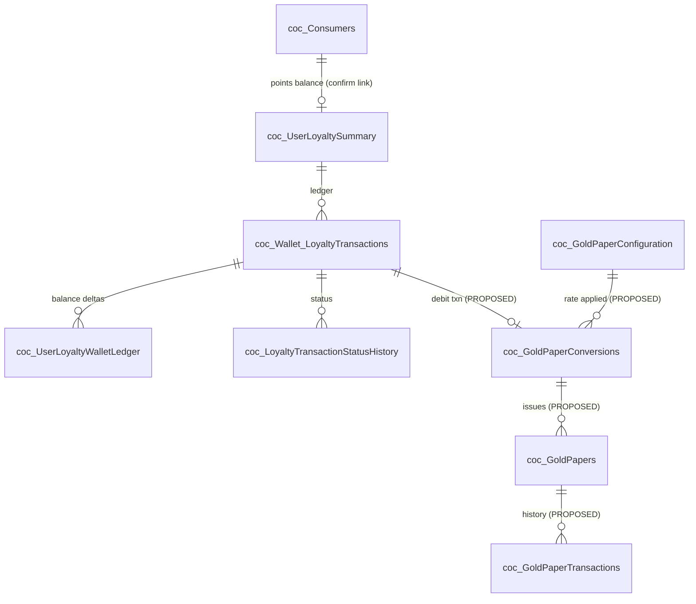
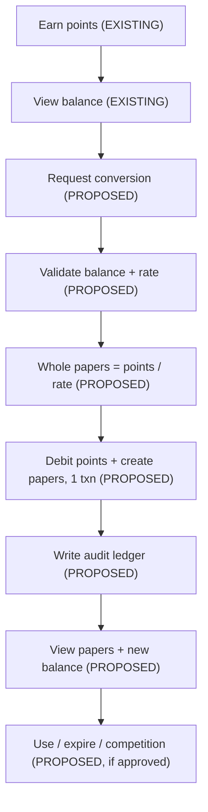

# Gold Paper — Technical Documentation (Simplified)

> Plain-English summary for developers, testers, and business stakeholders. ~5–10 minute read.
> This is **documentation only**. No code, SQL, database objects, or configuration were changed.
> Gold Paper is **not built yet** in eCopon. Everything about papers below is a **proposal**.
> Detailed references: the eight supporting documents in this folder (see
> [`README.md`](README.md)).

---

## Section 1: Overview

**What Gold Paper is meant to do.** Let a consumer turn their loyalty **points** into whole
**"papers"** at a fixed rate. Any leftover points (less than one paper) stay in the balance.

**How it fits into eCopon.** It sits next to the existing **loyalty eWallet**. The points it would
spend are the same loyalty points the mobile app already shows and the loyalty engine already awards.

**What can be reused (already exists in source):**
- Consumer points balance read — `EWallet/total-points` → `core_usp_Loyalty_GetTotalPointsByUserId_V2`.
- Points earning engine — `core_usp_Loyalty_AwardCampaignPoints_V2` (strong transaction + locking +
  idempotency pattern to copy).
- Wallet ledger and history — `coc_Wallet_LoyaltyTransactions`, `coc_UserLoyaltyWalletLedger`.
- Voucher redemption and cash withdrawal flows (same style of API + stored procedure).
- Consumer identity via JWT (`UserID` / `ConsumerID`).

**What is NOT implemented yet.** There is **no** Gold Paper code, API, screen, table, or stored
procedure anywhere in eCopon. Paper purchase, transfer, gifting, cashback, and expiry are explicitly
**not authorized** yet. The only concrete reference is the standalone POC (separate repo), whose rate
and rules are **not approved for production**.

---

## Section 2: Database Tables and Relationships

### 2.1 Existing tables that matter (verified from source)

| Table | Purpose | Existing or New | Relationship |
|---|---|---|---|
| `coc_Consumers` (`CocConsumer`) | Consumer master. Holds **legacy** points: `LoyaltyPoint`, `RedeemPoint`, and computed `BalancePoint = LoyaltyPoint − RedeemPoint`. | **Existing** | One consumer → many loyalty rows. PK `ConsumerID`. |
| `coc_UserLoyaltySummary` | **eWallet running points balance** (`CurrentPointsBalance`). This is the Phase‑2 balance the earning engine updates. | **Existing** (no `CREATE TABLE` in repo — confirm DDL) | One row per `UserID`. The balance a conversion would debit. |
| `coc_Wallet_LoyaltyTransactions` | Point transaction ledger (earn / redeem / withdraw). PK `TransactionID`. | **Existing** (DDL not in repo) | Many per user. Parent of status history & ledger. |
| `coc_UserLoyaltyWalletLedger` | Balance‑delta ledger (`BalanceBefore` / `BalanceAfter`). Has a `TransactionType` CHECK constraint. | **Existing** (DDL not in repo) | Many per user. A Gold Paper type would be added here. |
| `coc_LoyaltyTransactionStatusHistory` | Status change audit for each transaction. | **Existing** (DDL not in repo) | Many per `TransactionID`. |
| `coc_LoyaltyVoucherRedemptions` | Voucher redemption records. | **Existing** (DDL not in repo) | Links voucher + transaction. |
| `coc_UserPointConversions` | **Withdrawal** (points→cash) records. Holds `ConversionRate`. | **Existing** (DDL not in repo) | Not papers — different feature. Shown so it is not confused with Gold Paper. |
| `coc_LoyaltyCampaigns` (+ targets/awards) | Earning‑rule config. **Only loyalty tables with real `CREATE TABLE` in repo.** | **Existing** | Drives how points are awarded. |

> ⚠️ **Two different balances — do not mix them.** `coc_Consumers.BalancePoint` (legacy, computed)
> and `coc_UserLoyaltySummary.CurrentPointsBalance` (eWallet) are **separate**. No source proves they
> are the same, and neither is called "SMPoints". **Which balance Gold Paper debits must be confirmed
> by RM/Finance before build.**
>
> ⚠️ Most eWallet tables above are used by stored procedures but have **no `CREATE TABLE` script in
> the inspected repo**. Their exact columns/keys **require confirmation** against the live database.

### 2.2 Proposed new tables for Gold Paper (do not exist — proposal only)

These are the **minimum** tables a Gold Paper feature would need. They are **not created**. Names,
columns, and keys are suggestions to be reviewed.

**`coc_GoldPaperConfiguration`** — conversion settings (admin-managed).

| Column | Type | Notes |
|---|---|---|
| `GoldPaperConfigID` | `INT IDENTITY` | **PK** |
| `CorporateID` | `INT` | **FK** → `coc_Corporates` |
| `PointsPerPaper` | `INT` | conversion rate (**rate not approved**) |
| `IsEnabled` | `BIT` | on/off |
| `EffectiveFrom` / `EffectiveTo` | `DATETIME2` | validity window |

**`coc_GoldPaperConversions`** — one row per conversion attempt (success or rejection).

| Column | Type | Notes |
|---|---|---|
| `GoldPaperConversionID` | `BIGINT IDENTITY` | **PK** |
| `UserID` | `INT` | **FK** → consumer/user (confirm target) |
| `PointsRequested` | `INT` | |
| `PointsDebited` | `INT` | whole-papers × rate |
| `PapersIssued` | `INT` | |
| `RateUsed` | `INT` | snapshot of `PointsPerPaper` |
| `Status` | `TINYINT` | Completed / Rejected |
| `WalletTransactionID` | `BIGINT` | **FK** → `coc_Wallet_LoyaltyTransactions` |
| `IdempotencyKey` | `NVARCHAR(100)` | **Unique** with `UserID` (prevents double debit) |
| `CreatedDate` | `DATETIME2` | |

Suggested: `UQ_GoldPaperConversions_User_Idem (UserID, IdempotencyKey)`.

**`coc_GoldPapers`** — individual paper records.

| Column | Type | Notes |
|---|---|---|
| `GoldPaperID` | `BIGINT IDENTITY` | **PK** |
| `UserID` | `INT` | **FK** → consumer/user |
| `GoldPaperConversionID` | `BIGINT` | **FK** → `coc_GoldPaperConversions` |
| `Status` | `TINYINT` | Available / Used / Expired |
| `Source` | `TINYINT` | Conversion only (purchase/gift not authorized) |
| `CreatedDate` / `UsedDate` / `ExpiryDate` | `DATETIME2` | expiry only if approved |

Index suggestion: `IX_GoldPapers_User_Status (UserID, Status)`.

**`coc_GoldPaperTransactions`** — paper history (issuance, redemption, approved ops).

| Column | Type | Notes |
|---|---|---|
| `GoldPaperTransactionID` | `BIGINT IDENTITY` | **PK** |
| `GoldPaperID` | `BIGINT` | **FK** → `coc_GoldPapers` |
| `TransactionType` | `TINYINT` | Issued / Redeemed / (Transfer, Gift — only if approved) |
| `ReferenceID` | `BIGINT` | e.g. competition or conversion reference |
| `CreatedDate` | `DATETIME2` | |

### 2.3 ER diagram (existing vs. proposed)

Existing tables: `coc_Consumers`, `coc_UserLoyaltySummary`, `coc_Wallet_LoyaltyTransactions`,
`coc_UserLoyaltyWalletLedger`, `coc_LoyaltyTransactionStatusHistory`. Everything prefixed
`coc_GoldPaper*` is **proposed and does not exist**.

---

## Section 3: Screens and Integration

| Screen | User | Purpose | API/Service Required | Status |
|---|---|---|---|---|
| Points balance | Consumer | Show current loyalty points | `EWallet/total-points` (reuse) | **Existing** |
| Transaction history | Consumer | Show point movements | `EWallet/transactions` (reuse) | **Existing** |
| Loyalty admin (campaigns/vouchers/withdrawal) | Admin | Configure earning & redemption | `ecopon-2025` loyalty admin controllers (reuse) | **Existing** |
| Gold Paper config | Admin | Set rate, enable, limits | New admin API + `coc_GoldPaperConfiguration` | **Proposed** |
| Gold Paper balance & summary | Consumer | Show papers, rate, eligible points | `GET /mobile/GoldPaper/summary` | **Proposed** |
| Convert points → papers | Consumer | Do the conversion | `POST /mobile/GoldPaper/convert` (idempotent) | **Proposed** |
| View available / used papers | Consumer | List papers by status | `GET /mobile/GoldPaper/papers` | **Proposed** |
| Paper transaction history | Consumer | Paper issue/use audit | `GET /mobile/GoldPaper/history` | **Proposed** |
| Competition: extra chances from papers | Consumer | Use papers for chances | New link to competition SPs | **Proposed** (needs business approval) |
| Purchase / transfer / gift / cashback | Consumer | Paper trading | — | **Not implemented** (not authorized) |

Reuse notes: Gold Paper consumer APIs should follow the existing `Mobile.Api` `EWalletController`
pattern (controller → MediatR handler → `LoyaltyRepository` → stored procedure; **401 when
`userId <= 0`**). Admin config should follow the existing loyalty admin controller pattern in
`ecopon-2025`. All `GoldPaper/*` routes above are **proposed**; none exist today.

---

## Section 4: End-to-End Flow

Steps (**proposed** steps are marked):

1. Consumer earns loyalty points (**existing** — campaign award engine).
2. Consumer views eligible points balance (**existing** — `total-points`).
3. Consumer requests conversion to Gold Papers (**proposed**).
4. System validates balance and conversion rate (**proposed**).
5. System calculates whole papers = points ÷ rate; remainder stays (**proposed**).
6. System deducts points and creates paper records in one transaction (**proposed** — reuse the
   locking/idempotency pattern from `core_usp_Loyalty_AwardCampaignPoints_V2`).
7. System records the transaction for audit (**proposed** — write to wallet ledger + paper tables).
8. Consumer views updated balance and papers (**proposed**).
9. Approved paper usage / expiry / competition integration updates paper status and history
   (**proposed** — only if authorized).

**Illustrative POC calculation (NOT an approved rule):** 5,000 points ÷ 500 points-per-paper = **10
papers**; 5,000 points debited; 0 remainder. The **500 points-per-paper rate is a POC test
assumption and is not approved for production.** The POC even stores a flag
`RateIsApprovedBusinessRule = 0`. Do not treat this number as a business rule.

---

## Section 5: Final Implementation Report

| Item | Status | Next Action |
|---|---|---|
| Loyalty balance read API | Existing | Reuse `total-points` for preview/debit source |
| Points earning engine (award SPs) | Existing | Reuse transaction/locking/idempotency pattern |
| Wallet ledger + status history | Existing | Add Gold Paper transaction type (design) |
| Voucher / withdrawal / competition flows | Existing | Reference patterns; no change |
| Consumer identity (JWT) | Existing | Reuse for eligibility |
| `coc_GoldPaperConfiguration` | Proposed | Define & approve schema + rate |
| `coc_GoldPaperConversions` | Proposed | Define schema + idempotency unique key |
| `coc_GoldPapers` | Proposed | Define schema + status/source values |
| `coc_GoldPaperTransactions` | Proposed | Define schema + allowed operation types |
| Gold Paper consumer APIs (convert/summary/papers/history) | Proposed | Build after rules approved |
| Gold Paper admin config screen/API | Proposed | Build after rate/limits approved |
| Competition integration (papers → chances) | Pending confirmation | Confirm business requirement |
| Which balance is debited (legacy vs. eWallet) | Pending confirmation | RM/Finance to confirm |
| Conversion rate (points per paper) | Pending confirmation | RM/Finance to approve rate |
| Paper monetary value (e.g. "10 SAR") / "0.020 halala" | Pending confirmation | Not found in source; Finance to supply |
| Max papers / max extra chances | Pending confirmation | Product to supply limits |
| eWallet table DDL (confirm columns/keys) | Pending confirmation | Confirm against live DB |
| Purchase / transfer / gift / cashback of papers | Not implemented | Do not build until authorized |

**Recommended implementation order:**
1. Confirm business rules (which balance, rate, paper value, limits) — RM/Finance.
2. Confirm eWallet table DDL against the live database.
3. Design & approve the four proposed tables.
4. Build the conversion stored procedure (reuse the award-SP transaction pattern).
5. Expose consumer APIs (convert → summary → papers → history).
6. Add admin configuration screen/API.
7. Add tests mirroring the POC scenarios.
8. Only then consider expiry, competition integration, and (if authorized) purchase/transfer.

---

### Unverified / needs confirmation
- Which points balance Gold Paper debits (`coc_Consumers.BalancePoint` vs.
  `coc_UserLoyaltySummary.CurrentPointsBalance`).
- Exact columns/keys of all eWallet tables (no `CREATE TABLE` in repo).
- Conversion rate, paper monetary value ("10 SAR"), "0.020 halala", "SMPoints" label, and max
  limits — **none found in any inspected source**.
- Whether papers may grant competition chances, and purchase/transfer/gift/cashback — not authorized.

See the detailed documents for evidence: [`02-Database-Design.md`](02-Database-Design.md),
[`03-API-and-Service-Implementation.md`](03-API-and-Service-Implementation.md),
[`05-Business-Rules-and-Requirements.md`](05-Business-Rules-and-Requirements.md),
[`08-Implementation-Gaps-and-Technical-Plan.md`](08-Implementation-Gaps-and-Technical-Plan.md).
